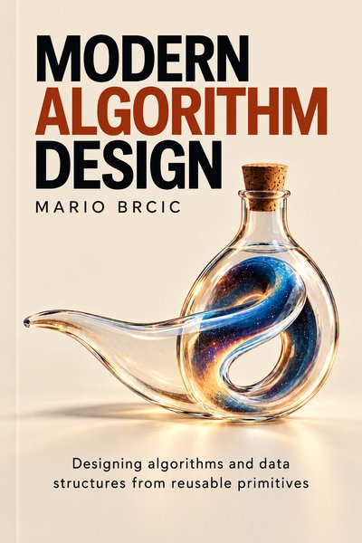

# algodesign

<a href="https://modernalgorithmdesign.com"></a>

The executable companion to **[Modern Algorithm Design](https://modernalgorithmdesign.com)**,
a textbook by [Mario Brcic](https://mariobrcic.com) about designing algorithms and data
structures from reusable primitives, for an age when code is cheap and knowing what to demand
of it is not.

The book teaches what to demand of a structure and why. This repository realizes each demand
three ways, and checks each one differently:

| | what it is for | how it is checked |
|---|---|---|
| **Python** · `python/algodesign/` | the version the book prints: read it, run it, change it | property-based tests against simple models |
| **Rust** · `rust/crates/algodesign/` | the engineered version: ownership, memory, speed | tests, property tests, benchmarks |
| **Lean 4** · `lean/AlgoDesign/` | the mathematical object: what the structure promises, stated and proved | the Lean kernel |

All three implement the same variant of each algorithm, the one the book chooses. They are not
translations of each other: each is written the way its language is best at, and the book uses
the differences. Delete a key from a search tree, and the Python moves the node object, so a
reference held elsewhere still points at a live key; the Rust hands out no node that outlives an
update, so the question cannot be asked of it; and the Lean works on values alone, and proves that
the two classic ways of deleting build the same tree.

## Tested, proved, and proved right

Three different claims, never conflated here:

- **Tested**: the code agreed with a model on every input the tests tried.
- **Proved**: a theorem about the Lean definition holds, checked by Lean's kernel with only its
  standard axioms. `lean/CheckAxioms.lean` enforces this: no `sorry`, no custom axioms.
- **Proved the right thing**: whether a theorem states what you actually wanted is a question no
  tool answers. That is the part the book teaches.

The three languages are also run against each other: on shared inputs, the Lean definitions, the
Rust and the Python must give the same answers and judge the same structures valid or broken. The book says, for each check it relies on, what that
check covers.

## What is here

A topic appears when its chapter is published.

| topic | chapter | contents |
|---|---|---|
| `contracts` | Contracts and cost models | ball weighing by three-way division |
| `searching` | Search | sequential and binary search, the binary search tree, the left-leaning and the standard red-black tree, the treap, the B-tree, the LSM-tree |
| `strings` | Strings | Rabin–Karp fingerprint search, the trie and the Patricia tree, the suffix array and its longest common prefixes, the Burrows–Wheeler transform, rank and select, the FM-index, and records: from a hit to the whole record |
| `geometry` | Geometry | the scan, the orientation test and the convex hull, the 1D and 2D range trees, the k-d tree, random projection, locality-sensitive hashing (SimHash and p-stable), the graph index (HNSW) and RaBitQ's one-bit codes |

## Reading along with the book

You need Python 3.12 or newer, and nothing else to follow the book.

```sh
git clone https://github.com/mbrcic/algodesign
cd algodesign/python
python3 -m venv .venv && . .venv/bin/activate
pip install -e .
python -c "import algodesign.searching, algodesign.strings, algodesign.geometry"
```

The last line prints nothing if the install worked. Each chapter's Python is in
`python/algodesign/<topic>/`, one module per structure, named as in the book.

Build a structure, break it by hand, and ask which promise broke:

```python
from algodesign.searching import LLRB

tree = LLRB([10, 20, 30, 15, 5])
print(tree.check_valid())      # None
tree.root.left.red = False     # repaint the link into 10 black
print(tree.check_valid())      # invariant 5 (black_height_ok)
```

Each structure the book designs has a predicate `Valid` in the Lean: the checkable invariants of
its box *The design*, in its order, then any the code needed that the box did not state. In Python
and Rust, `is_valid()` checks the whole of it. Where the pieces are split out, each piece of the
box is a function named `is_` followed by the piece's name, and `check_valid()` names the first
piece that fails. A check the code needs only for what it stores besides (a cached size, a count)
keeps a plain name, such as `sizes_add_up()`:

| topic | `is_valid()` | one `is_…()` per piece of the box, and `check_valid()` |
|---|---|---|
| `searching` | every search tree | the BST, the left-leaning red-black tree, the B-tree and the LSM-tree |
| `strings` | every structure with a design box, and the quote store | the same structures |
| `geometry` | the range trees, the k-d tree, the LSH index and the graph index | the same structures |

Each such structure's `Spec.lean` opens with its box, quoted word for word, then goes through it
field by field. Each field carries one word saying how far it is checked:

- *proved*: a Lean theorem;
- *tested*: tests in Python and Rust, not a proof;
- *measured*: a number from a run, such as a timing or a count;
- *argued*: a reason in prose, left unproved on purpose because a proof would not pay;
- *mentioned*: stated, but not something code can check, such as an assumption about the workload;
- *required*: something every implementation must supply;
- *none*: the box says nothing there.

A field checked in several ways carries the weakest of them, in the order proved, tested, measured,
argued; *required*, *mentioned* and *none* say what a field is, not how well it is checked.
`Contract` gathers the laws Lean checks, and the theorem `contract` proves that the library's
operations meet them.

## Running it


```sh
# Python 3.12+
cd python && python3 -m venv .venv && . .venv/bin/activate && pip install -e ".[dev]" && mypy --strict algodesign/ tests/ && pytest

# Rust (the pinned toolchain installs itself through rustup)
cd rust && cargo test --workspace && cargo clippy --workspace --all-targets -- -D warnings

# Lean (downloads Mathlib's build cache on first run)
cd lean && lake exe cache get && lake build && lake env lean CheckAxioms.lean
```

## Sources

The algorithms are the published ones, and each module cites the source whose variant it
implements. The code is written from those descriptions, not copied from other implementations.

## License

Code: Apache License 2.0; see `LICENSE`. The book's text and cover are © Mario Brcic, all rights
reserved, and are not covered by this license.
